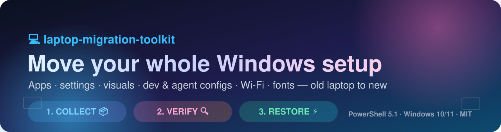
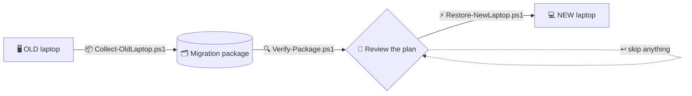

<div align="center">



<br><br>

[](https://github.com/samayshetty/laptop-migration-toolkit/releases)
[](LICENSE)
[](#-requirements)
[](#-requirements)
[](#-no-administrator-rights)
[](#-contributing)

### 🖥️ ➜ 💻 &nbsp; Move your **entire** Windows setup to a new laptop
**apps · settings · visuals · dev &amp; AI-agent configs · Wi-Fi · fonts · files**

<p>
<a href="#-quick-start"><kbd>🚀 Quick start</kbd></a>
<a href="#-what-gets-migrated"><kbd>📦 What gets migrated</kbd></a>
<a href="#-per-app-granularity"><kbd>🎛️ Per-app modes</kbd></a>
<a href="#-conflict-handling"><kbd>🛡️ Conflict handling</kbd></a>
<a href="#-no-administrator-rights"><kbd>🔓 No admin rights?</kbd></a>
<a href="wiki/"><kbd>📚 Full wiki</kbd></a>
</p>

</div>

---

## 🌈 Why this toolkit

| 😩 The usual way | ✨ With laptop-migration-toolkit |
| :-- | :-- |
| Manually reinstall 50 apps from memory | 📋 **winget** inventory, reinstall exactly what you pick |
| Screenshot your settings and rebuild them by hand | 🎨 Theme, taskbar, wallpaper, input settings restored as `.reg` |
| Lose your VS Code extensions, terminals, agent configs | 🧩 **VS Code**, **Windows Terminal**, **PowerShell profiles**, **opencode / Claude / Codex / Gemini / Cursor** |
| Re-type every Wi-Fi password | 📶 Wi-Fi profiles **with passwords** |
| Hope nothing breaks across Windows versions | 🛡️ Version-aware plan with **recommended skips** and **automatic backups** |
| Blocked by a locked-down corporate laptop | 🔓 Works as a **standard user** - no admin required |

> [!TIP]
> Everything runs as **plain PowerShell 5.1** - no agents, no installers, no vendor tools.
> If you can copy a folder to a USB drive, you can migrate a laptop.

---

## 🚀 Quick start

> [!TIP]
> **Prefer a window?** `.\Start-MigrationGui.ps1` does all three steps with clickable
> options and a live log - see **[Using the GUI](wiki/Using-the-GUI.md)**.

> [!IMPORTANT]
> Collect on the **old** laptop, verify then restore on the **new** one.

```powershell
# ─────────────────────────────────────────────────────────────
#  1️⃣  OLD laptop  ·  collects everything into one portable package
#      (an Administrator window is recommended, but optional)
# ─────────────────────────────────────────────────────────────
.\Collect-OldLaptop.ps1 -OutputPath "$env:OneDriveCommercial\MigrationPackage" -InteractiveApps

# ─────────────────────────────────────────────────────────────
#  2️⃣  NEW laptop  ·  read-only review before you touch anything
# ─────────────────────────────────────────────────────────────
.\Verify-Package.ps1 -PackagePath "$env:OneDriveCommercial\MigrationPackage"

# ─────────────────────────────────────────────────────────────
#  3️⃣  NEW laptop  ·  editable plan, then restore
# ─────────────────────────────────────────────────────────────
.\Restore-NewLaptop.ps1 -PackagePath "$env:OneDriveCommercial\MigrationPackage"
```

Need a dry run first? Add `-VerifyOnly` to the restore - it prints the full plan and changes nothing.

> [!TIP]
> **Never used GitHub or PowerShell before?** The wiki walks you through every click:
> download the ZIP, extract it, open PowerShell in the right folder, open it as
> Administrator, allow the script to run and fix any first-run error.
> Start at **[First-Time Setup](wiki/First-Time-Setup.md)**.



<div align="center">

| Step | Script | Where | Emoji |
| :--: | :-- | :--: | :--: |
| 1 | `scripts/Collect-OldLaptop.ps1` | 🖥️ old | 📦 |
| 2 | `scripts/Verify-Package.ps1` | 💻 new | 🔍 |
| 3 | `scripts/Restore-NewLaptop.ps1` | 💻 new | ⚡ |
| ☝️ | `scripts/Start-MigrationGui.ps1` | either | 🖼️ |

</div>

> [!TIP]
> Not a terminal person? **`Start-MigrationGui.ps1`** puts all three steps in a window:
> pick the task, pick the folder, tick options, press **Run**, watch the colour-coded log.
> No install and no admin rights - see **[Using the GUI](wiki/Using-the-GUI.md)**.

---

## 🧩 The scripts

| Script | Run it on | What it does |
| --- | --- | --- |
| `scripts/Start-MigrationGui.ps1` | either laptop | Optional window that runs the other three for you |
| `scripts/Collect-OldLaptop.ps1` | 🖥️ old laptop | Collects everything into one portable "migration package" |
| `scripts/Verify-Package.ps1` | 💻 new laptop | Read-only review of the package before you restore |
| `scripts/Restore-NewLaptop.ps1` | 💻 new laptop | Interactive plan editor + restore engine |

---

## 📦 What gets migrated

<table>
<tr>
<td valign="top" width="50%">

**🧰 Applications**
- winget inventory &amp; reinstall
- per-app install / data / both / skip
- desktop + Microsoft Store apps listed

**🎨 Visuals**
- theme, accent colours
- taskbar layout &amp; pinned items
- wallpaper
- mouse, keyboard, region

**⚙️ Power &amp; system**
- power scheme
- user environment variables
- user-installed fonts

</td>
<td valign="top" width="50%">

**🧑‍💻 Developer &amp; agent configs**
- VS Code settings + extension list
- Windows Terminal, PowerShell profiles
- opencode, Claude, Codex, Gemini, Cursor
- dotfiles (`.npmrc`, `.wslconfig`, `.vimrc`, `.gitconfig`)
- browser bookmarks (Chrome, Edge)

**🔐 Optional / sensitive**
- SSH keys (opt-out, locked-down permissions)
- Wi-Fi profiles with passwords
- personal folders (Desktop, Documents, Downloads, ...)

</td>
</tr>
</table>

<details>
<summary><b>🗂️ Package layout (click to expand)</b></summary>

```
MigrationPackage/
├── system-info.json          machine, user, OS & build, toolkit version
├── apps/                     winget export + your app selection
├── personalization/          theme, taskbar, wallpaper, input (.reg)
├── terminals/                Windows Terminal settings
├── dev/                      VS Code, agent configs, dotfiles,
│                             PowerShell profiles, bookmarks, SSH
├── env/                      user environment variables
├── wifi/                     Wi-Fi profiles (passwords when elevated)
├── power/                    active power scheme
├── fonts/                    user-installed font files
├── files/                    personal folders (opt-in)
└── collection-report.json    full log of the collection run
```

</details>

---

## 🎛️ Per-app granularity

For **every** app you decide what travels (set it during collection with `-InteractiveApps`, or press <kbd>a</kbd> in the restore plan editor):

| Mode | 🧩 | Meaning |
| :--: | :--: | :-- |
| `both` | ✅✅ | Install the app **and** restore its data |
| `app` | ⬇️ | Install the app only |
| `data` | 📁 | Restore the app's data only (no install) |
| `skip` | ⏭️ | Ignore this app completely |

---

## 🛡️ Conflict handling

| Situation | What the toolkit does |
| :-- | :-- |
| 🪟 **Windows 10 ➜ 11** (or build change) | Pre-sets taskbar, theme & pinned items to **SKIP** and tells you why - override any time |
| 👤 **Different user name / domain** | Translates old profile paths to the new ones |
| 📄 **File already exists** | Backs it up first - restore files by hand from `MigrationBackup-<date>` on the Desktop |
| 🗝️ **Registry key already set** | Exports the old value as `.reg` into the same backup folder |
| ☁️ **Folder already synced by OneDrive** | Detected and skipped for files, so you don't get duplicates |
| 📦 **App already installed** | Detected, not reinstalled |
| 📶 **Wi-Fi profile already present** | Skipped instead of duplicated |

---

## 🔓 No Administrator rights

> [!NOTE]
> On a locked-down corporate laptop you are often a **standard user**. That's fine.

| Step | Without admin |
| :-- | :-- |
| 📦 Collect | Works - Wi-Fi **passwords** and the power scheme are skipped |
| ⚡ Restore | Works - only the **power scheme** is skipped (marked `SKIP` in the plan) |

The restore detects it automatically, doesn't ask for elevation you can't grant, restores everything else and reminds you at the end. **A skipped admin-only step is not an error - the run still reports `0 errors`.**

```text
 Skipped (Administrator rights required): Power scheme.
 Everything else was restored. To apply the power scheme later, run this same
 script again from an Administrator PowerShell - re-running is safe.
```

📖 Details: **[No Administrator Rights](wiki/No-Administrator-Rights.md)**

---

## ✨ Options worth knowing

| Script | Option | Why you want it |
| :-- | :-- | :-- |
| Collect | `-Archive` | also writes a single `.zip` - **much** faster to copy than 40 000 small files |
| Collect | `-IncludeUserFiles` | also copy Desktop, Documents, Downloads, Pictures, Videos, Music |
| Collect | `-SkipSSH` | never collect `~\.ssh` (use it for any cloud drive) |
| Collect | `-IncludeVscodeHistory` | keep VS Code edit history (off by default: it's a cache) |
| Collect | `-InteractiveApps` | pick apps up front, saved into the package |
| Restore | `-VerifyOnly` | print the plan, change nothing |
| Restore | `-SkipApps` / `-SkipRegistry` / `-SkipWifi` / `-SkipFonts` / `-SkipEnvVars` / `-SkipSSH` | fine-grained control for automation |
| Restore | `-NonInteractive` | recommended defaults, no prompts |
| Any | `-NoElevate` | never offer to relaunch as Administrator |

<details>
<summary><b>📖 All collection parameters</b></summary>

| Parameter | What it does |
| :-- | :-- |
| `-OutputPath <folder>` | Where to build the package. Default `Desktop\MigrationPackage-<date>`. |
| `-InteractiveApps` | Choose exactly which apps to carry over. |
| `-IncludeUserFiles` | Also copy Desktop, Documents, Downloads, Pictures, Videos, Music. |
| `-ExtraFolders "D:\Projects"` | Copy folders outside your user profile. |
| `-SkipSSH` | Do not collect `~\.ssh`. |
| `-SkipApps` | Skip the application inventory. |
| `-IncludeVscodeHistory` | Include VS Code edit history / workspace storage. |
| `-IncludeCursorExtensions` | Include installed Cursor extensions. |
| `-Archive` | Also write a single `.zip` next to the folder. |
| `-NonInteractive` | Never prompt. |
| `-NoElevate` | Do not offer to relaunch as Administrator. |

</details>

---

## ✅ Requirements

| | |
| :-- | :-- |
| 🪟 **OS** | Windows 10 1809+ or Windows 11 |
| ⚡ **Shell** | PowerShell 5.1 (built in - nothing to install) |
| 📦 **Apps** | `winget` (App Installer) for automatic installation |
| 🔑 **Rights** | **optional** - only Wi-Fi passwords &amp; the power scheme need Administrator |
| 💾 **Transfer** | OneDrive/SharePoint, USB drive or a network share |

> [!WARNING]
> A package can contain **Wi-Fi passwords, sign-in tokens and (opt-in) SSH private keys**.
> Keep it in a private place, never commit it, and delete it once the migration is done.
> `scripts/Verify-Package.ps1` scans for exactly these before you restore.

---

## 📚 Documentation

| Page | What's inside |
| :-- | :-- |
| 🏠 [Home](wiki/Home.md) | Wiki landing page |
| 🧑‍🏫 [First-Time Setup](wiki/First-Time-Setup.md) | **Absolute-beginner walkthrough**: download, unzip, open PowerShell, run it, fix first-run errors |
| 🖼️ [Using the GUI](wiki/Using-the-GUI.md) | The optional window: tasks, options, live log, tips |
| 🚀 [Getting Started](wiki/Getting-Started.md) | Requirements &amp; the 5-minute overview |
| 📦 [Collect from the Old Laptop](wiki/Collect-from-the-Old-Laptop.md) | Every parameter explained |
| 🔍 [Verify the Package](wiki/Verify-the-Package.md) | Reading the verification report |
| ⚡ [Restore on the New Laptop](wiki/Restore-on-the-New-Laptop.md) | The plan editor &amp; restore engine |
| 🎛️ [App Selection and Granularity](wiki/App-Selection-and-Granularity.md) | The four per-app modes |
| ⚠️ [Conflicts and Version Mismatch](wiki/Conflicts-and-Version-Mismatch.md) | What happens when laptops differ |
| 🔐 [Security and Privacy](wiki/Security-and-Privacy.md) | What is sensitive and how to handle it |
| 🔓 [No Administrator Rights](wiki/No-Administrator-Rights.md) | Locked-down laptop? Start here |
| 🧰 [Troubleshooting](wiki/Troubleshooting.md) | Common errors and fixes |
| ❓ [FAQ](wiki/FAQ.md) | Quick answers |

---

## 🗂️ Repository layout

```text
scripts/   Start-MigrationGui.ps1 | Collect-OldLaptop.ps1 | Verify-Package.ps1 | Restore-NewLaptop.ps1
wiki/      full documentation (start at Home)
assets/    banner artwork
docs/      helper to publish the wiki
```

## 🤝 Contributing

Ideas, bug reports and pull requests are welcome - the most useful thing you can send is
a **new app-data mapping** (tell us which bundle an app's data should restore from).

## 📄 License

**MIT** - see [LICENSE](LICENSE).

<div align="center">
<br>

**Found it useful? Drop a ⭐ - it helps others find it.**

<sub>Built for real laptop swaps on locked-down corporate machines.</sub>

</div>
