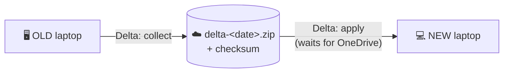

# 🔁 Delta Sync - keep working on the old laptop

<div align="center">

[Home](Home) &#183; [Setup](First-Time-Setup) &#183; [GUI](Using-the-GUI) &#183; [Getting Started](Getting-Started) &#183; [Collect](Collect-from-the-Old-Laptop) &#183; [Verify](Verify-the-Package) &#183; [Restore](Restore-on-the-New-Laptop) &#183; [Delta Sync](Delta-Sync) &#183; [App Modes](App-Selection-and-Granularity) &#183; [Conflicts](Conflicts-and-Version-Mismatch) &#183; [Security](Security-and-Privacy) &#183; [No Admin](No-Administrator-Rights) &#183; [Troubleshooting](Troubleshooting) &#183; [FAQ](FAQ)

</div>

---

You restored yesterday, but kept working on the old laptop today? **Delta sync** carries over
changed settings plus complete VS Code chat bundles as **one zip**, and applies it on the
new laptop with backups and content-based chat conflict checks. This is a one-way migration
workflow, not a two-way merge service. Chat bundles/attachments can make the zip large.

## Upgrading after an existing full backup

No need to repeat the full backup:

1. Download the latest repository ZIP (or run `git pull --ff-only` in a clean clone).
   Update the **whole `scripts` folder on both laptops**, including `ChatHistory.ps1`
   and `MigrationCommon.ps1`. Do not replace only the GUI or delta script.
2. Keep the existing package and delta archives. Use a private transfer folder belonging
   to this person, not someone else's migration package or OneDrive account.
3. On the new laptop, open each desired project folder once in the appropriate edition
   (Stable / Insiders), then close **both editions** on both laptops.
4. Start the GUI from standalone Windows PowerShell on the **old laptop**.
   Choose **Delta: collect changes since last sync (old)** and a private `MigrationDelta`
   folder. Leave **Changed since** blank if automatic detection works; otherwise enter
   the date/time of the original full backup (or an earlier date to recover missed settings).
   The one-hour overlap shown in the log is intentional. Leave the optional user-files
   checkbox off if those folders already sync through OneDrive.
5. Wait for successful collection and transfer of **both** the new zip and its `.zip.json`
   checksum. Use the same person's OneDrive on their two laptops, or copy both files by USB.
6. On the **new laptop**, reopen the updated GUI outside VS Code. Choose **Delta: apply changes
   (new laptop)** and the transfer folder. Save work before using **Close apps first**;
   this forcibly closes those apps. Tick **Do not install missing VS Code extensions**
   if only data needs updating. Run and save the log.
7. Choose **Fix missing per-folder VS Code chats (new)**. Untick **Apply** for a preview;
   then tick it and run if the plan is correct. Save the log. Delta apply also runs this
   repair automatically unless explicitly skipped.
8. Reopen the same project in the same VS Code edition and verify the latest messages
   and attachments. Stable and Insiders histories are not merged into each other.

Fresh deltas include chats, indexes, editing state, transcripts, attachments and checkpoints
even when their file dates predate the cutoff. This recovers chat data omitted by older full
backups. It cannot recover data already deleted from the old laptop.

Repair groups matching workspace URIs. If the project moved to a different drive, username
or folder path, automatic relinking may not find a match; retain the data and review the
workspace mapping rather than renaming hashes or replacing databases manually.



## 🖱️ With the GUI

| Laptop | Task | Folder | Press |
| :--: | :-- | :-- | :--: |
| 🖥️ old | **Delta: collect changes since last sync (old)** | `OneDrive\MigrationDelta` (default) | **Run** |
| 💻 new | **Delta: apply changes (new laptop)** | the same OneDrive folder | **Run** |

Close **both VS Code editions** before collection/apply. Launch the GUI outside the editors.

Leave **Changed since** empty: the cut-off is taken automatically from the previous delta, or
from the full package's `system-info.json` for the first delta.

> [!TIP]
> You can press **Run** on the new laptop **straight away**. It waits until OneDrive has
> delivered the whole zip, checks its SHA-256 checksum, and only then starts. The log shows
> `Waiting for OneDrive: ... still uploading` / `downloading` every 30 seconds.

## ⌨️ From PowerShell

```powershell
# OLD laptop
.\Sync-Delta.ps1 -Mode Collect                        # -> OneDrive\MigrationDelta\delta-<date>.zip
.\Sync-Delta.ps1 -Mode Collect -Since "2026-10-17 09:00"   # explicit cut-off

# NEW laptop
.\Sync-Delta.ps1 -Mode Apply -Path "$env:OneDriveCommercial\MigrationDelta" -CloseApps
```

| Parameter | Mode | What it does |
| :-- | :--: | :-- |
| `-Path` | both | Collect: where to write the zip. Apply: all unapplied zips in the folder, oldest first, or one explicit zip |
| `-Since <date>` | collect | Override the automatic cut-off |
| `-IncludeUserFiles` | collect | Also changed Desktop / Documents / Pictures (skipped when redirected to OneDrive) |
| `-CloseApps` | apply | Close VS Code, Insiders, Notepad, Notepad++, OneNote, Chrome and Edge first |
| `-SkipExtensions` | apply | Do not install missing VS Code extensions |
| `-SkipChatRelink` | apply | Do not run the per-folder chat repair at the end |
| `-BackupPath` | apply | Optional backup destination instead of a timestamped Desktop folder |

## 📦 What a delta contains

| Area | Details |
| :-- | :-- |
| **VS Code + VS Code Insiders** | Changed settings plus complete chat sessions, per-folder/empty-window indexes, editing state, transcripts, checkpoints and `agentSessionData` attachments; extension lists for both |
| **Notepad / Notepad++ / OneNote** | Windows Notepad settings and open tabs, Notepad++ config, OneNote desktop options (+ registry) |
| **Browsers** | **All** Chrome and Edge profiles (`Default`, `Profile 1`, ...): bookmarks + preferences, and the profile list so they appear in the profile picker |
| **Agents &amp; dotfiles** | `.claude`, `.codex`, `.gemini`, `.copilot`, `.kube`, `.azure`, `.gitconfig`, `.npmrc`, ... |
| **Windows Terminal, PowerShell profiles** | settings and profile scripts |

Caches, `node_modules`, `.git`, logs, edit history and Copilot index databases are skipped.
Sign-ins and saved browser passwords are encrypted per machine and **cannot** be carried over -
sign in again and let the browser's own sync do the rest.

## 🛡️ Safety rules on apply

- Ordinary files use modification dates; **chats use replayed conversation contents**.
  A complete continuation can replace a shorter history even when the shorter file has
  a newer timestamp. A longer/newer local continuation is retained.
- Divergent, unreadable or ambiguous chat copies are reported, not overwritten.
- Workspace/global `state.vscdb` files are not replaced wholesale on existing workspaces:
  only accepted session-index entries are merged. Other settings and local-only chats stay.
- Every overwritten file is backed up to `Desktop\MigrationBackup-delta-<date>`.
- Applying the same zip twice is detected and skipped.
- A delta with import failures is not recorded as applied and later deltas are stopped.
  Some accepted files may already have been copied; review errors/backups, resolve the cause
  and retry. This is not an all-or-nothing transaction.
- A failed collection does not advance its cutoff. Required online-only chat data must be
  downloaded on the old laptop before collecting.
- Both editors must be closed; `-Force` on repair does not bypass this check.

## 💬 Missing per-folder VS Code chats?

VS Code keys each window's chat history by the folder's path **and creation time**. On a new
laptop (or after OneDrive re-creates the folder) the key changes, so the window opens with an
empty Sessions list although the chats were restored.

Fix: open each project folder once in VS Code / Insiders on the new laptop, **close VS Code**,
then run **Fix missing per-folder VS Code chats (new)** in the GUI, or:

```powershell
.\Repair-WorkspaceChats.ps1          # preview
.\Repair-WorkspaceChats.ps1 -Apply   # copy old chat data into the new window ids (backed up first)
```

Delta apply runs this automatically at the end when VS Code is closed.

If automatic repair reports conflicts after import, run the repair preview separately.
Imported deltas can already be recorded as applied even when this later repair step needs
manual review. Unindexed sessions are retained but are not published with invented metadata.
