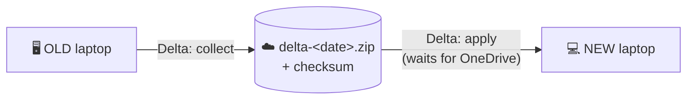

# 🔁 Delta Sync - keep working on the old laptop

<div align="center">

[Home](Home) &#183; [Setup](First-Time-Setup) &#183; [GUI](Using-the-GUI) &#183; [Getting Started](Getting-Started) &#183; [Collect](Collect-from-the-Old-Laptop) &#183; [Verify](Verify-the-Package) &#183; [Restore](Restore-on-the-New-Laptop) &#183; [Delta Sync](Delta-Sync) &#183; [App Modes](App-Selection-and-Granularity) &#183; [Conflicts](Conflicts-and-Version-Mismatch) &#183; [Security](Security-and-Privacy) &#183; [No Admin](No-Administrator-Rights) &#183; [Troubleshooting](Troubleshooting) &#183; [FAQ](FAQ)

</div>

---

You restored yesterday, but kept working on the old laptop today? **Delta sync** carries over
only what changed since the last sync - as **one small zip** - and applies it on the new
laptop without overwriting anything you already changed there.



## 🖱️ With the GUI

| Laptop | Task | Folder | Press |
| :--: | :-- | :-- | :--: |
| 🖥️ old | **Delta: collect changes since last sync (old)** | `OneDrive\MigrationDelta` (default) | **Run** |
| 💻 new | **Delta: apply changes (new laptop)** | the same OneDrive folder | **Run** |

Leave **Changed since** empty: the cut-off is taken automatically from the previous delta, or
from the full package's `system-info.json` for the first delta.

> [!TIP]
> You can press **Run** on the new laptop **straight away**. It waits until OneDrive has
> delivered the whole zip, checks its SHA-256 checksum, and only then starts. The log shows
> `Waiting for OneDrive: ... still uploading` / `downloading` every 30 seconds.

## ⌨️ From PowerShell

```powershell
# OLD laptop
.\Sync-Delta.ps1 -Mode Collect                        # -> OneDrive\MigrationDelta\delta-<date>.zip
.\Sync-Delta.ps1 -Mode Collect -Since "2026-10-17 09:00"   # explicit cut-off

# NEW laptop
.\Sync-Delta.ps1 -Mode Apply -Path "$env:OneDriveCommercial\MigrationDelta" -CloseApps
```

| Parameter | Mode | What it does |
| :-- | :--: | :-- |
| `-Path` | both | Collect: where to write the zip. Apply: the folder (newest zip is used) or a zip |
| `-Since <date>` | collect | Override the automatic cut-off |
| `-IncludeUserFiles` | collect | Also changed Desktop / Documents / Pictures (skipped when redirected to OneDrive) |
| `-CloseApps` | apply | Close VS Code, Insiders, Notepad, Notepad++, OneNote, Chrome and Edge first |
| `-SkipExtensions` | apply | Do not install missing VS Code extensions |
| `-SkipChatRelink` | apply | Do not run the per-folder chat repair at the end |

## 📦 What a delta contains

| Area | Details |
| :-- | :-- |
| **VS Code + VS Code Insiders** | `User` folder: settings, keybindings, snippets, prompts / custom agents, Copilot chat sessions and per-folder chat history; extension lists for both |
| **Notepad / Notepad++ / OneNote** | Windows Notepad settings and open tabs, Notepad++ config, OneNote desktop options (+ registry) |
| **Browsers** | **All** Chrome and Edge profiles (`Default`, `Profile 1`, ...): bookmarks + preferences, and the profile list so they appear in the profile picker |
| **Agents &amp; dotfiles** | `.claude`, `.codex`, `.gemini`, `.copilot`, `.kube`, `.azure`, `.gitconfig`, `.npmrc`, ... |
| **Windows Terminal, PowerShell profiles** | settings and profile scripts |

Caches, `node_modules`, `.git`, logs, edit history and Copilot index databases are skipped.
Sign-ins and saved browser passwords are encrypted per machine and **cannot** be carried over -
sign in again and let the browser's own sync do the rest.

## 🛡️ Safety rules on apply

- A file is written **only if the zip's copy is newer** than the one on the new laptop.
- Every overwritten file is backed up to `Desktop\MigrationBackup-delta-<date>`.
- Applying the same zip twice is detected and skipped.
- Locked files (app still open) are reported as warnings - tick *Close ... first* and re-run.

## 💬 Missing per-folder VS Code chats?

VS Code keys each window's chat history by the folder's path **and creation time**. On a new
laptop (or after OneDrive re-creates the folder) the key changes, so the window opens with an
empty Sessions list although the chats were restored.

Fix: open each project folder once in VS Code / Insiders on the new laptop, **close VS Code**,
then run **Fix missing per-folder VS Code chats (new)** in the GUI, or:

```powershell
.\Repair-WorkspaceChats.ps1          # preview
.\Repair-WorkspaceChats.ps1 -Apply   # copy old chat data into the new window ids (backed up first)
```

Delta apply runs this automatically at the end when VS Code is closed.
