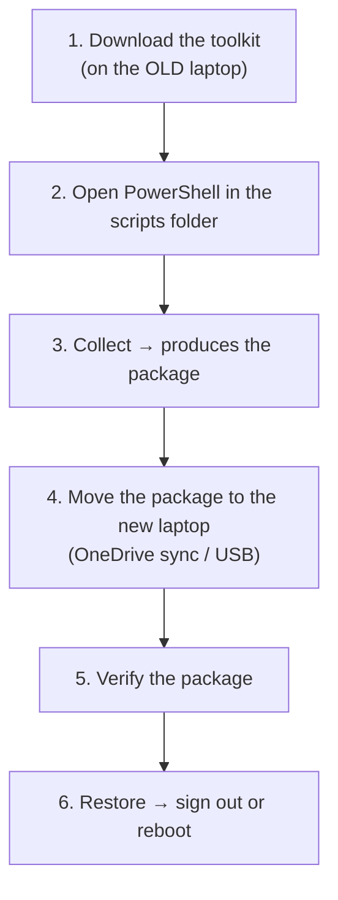

# 🚀 Getting Started

<div align="center">

[Home](Home) &#183; [Setup](First-Time-Setup) &#183; [Getting Started](Getting-Started) &#183; [Collect](Collect-from-the-Old-Laptop) &#183; [Verify](Verify-the-Package) &#183; [Restore](Restore-on-the-New-Laptop) &#183; [App Modes](App-Selection-and-Granularity) &#183; [Conflicts](Conflicts-and-Version-Mismatch) &#183; [Security](Security-and-Privacy) &#183; [No Admin](No-Administrator-Rights) &#183; [Troubleshooting](Troubleshooting) &#183; [FAQ](FAQ)

</div>

---

> [!TIP]
> **Brand new to GitHub / PowerShell?** Go to **[🧑‍🏫 First-Time Setup](First-Time-Setup)** first - it shows
> every click (download, unzip, open PowerShell, run the script). This page is the
> short version for people who are comfortable in a terminal.

## 🧾 What you need

| | |
| :-- | :-- |
| 🖥️💻 **Two laptops** | old one (has your stuff) and new one (empty-ish). One at a time is fine. |
| 🪟 **Windows** | 10 (1809+) or 11 - on both |
| ⚡ **PowerShell** | 5.1, built into Windows - **nothing to install** |
| 📦 **winget** | "App Installer" from the Microsoft Store, on the **new** laptop (for app installation) |
| 💾 **A way to move files** | OneDrive/SharePoint, a USB stick, or a network share |
| 🔑 **Administrator** | **optional** - only Wi-Fi passwords &amp; the power scheme need it ([details](No-Administrator-Rights)) |

## 🧭 The whole job in 6 steps



| # | Where | What you do | Learn more |
| :--: | :--: | :-- | :-- |
| 1 | 🖥️ old | Download the toolkit to `C:\Migration\laptop-migration-toolkit` | [First-Time Setup](First-Time-Setup) |
| 2 | 🖥️ old | Open PowerShell **inside the `scripts` folder** | [First-Time Setup](First-Time-Setup) |
| 3 | 🖥️ old | `.\Collect-OldLaptop.ps1 -OutputPath "<package folder>"` | [Collect](Collect-from-the-Old-Laptop) |
| 4 | 🔁 | Let OneDrive finish syncing, or copy the folder to USB | [Collect](Collect-from-the-Old-Laptop) |
| 5 | 💻 new | `.\Verify-Package.ps1 -PackagePath "<package folder>"` | [Verify](Verify-the-Package) |
| 6 | 💻 new | `.\Restore-NewLaptop.ps1 -PackagePath "<package folder>"` | [Restore](Restore-on-the-New-Laptop) |

## ⌨️ Copy-paste version

Put the scripts in the same place on both laptops (`C:\Migration\laptop-migration-toolkit\scripts`).
Open **PowerShell** there - the easiest way is to type `powershell` in the File Explorer
**address bar** while you are inside the `scripts` folder.

**Step 1 - always run this first (once per PowerShell window):**

```powershell
Set-ExecutionPolicy -Scope Process Bypass -Force
```

**Step 2 - on the OLD laptop (collect):**

```powershell
.\Collect-OldLaptop.ps1 -OutputPath "$env:OneDriveCommercial\MigrationPackage" -InteractiveApps
```

- `$env:OneDriveCommercial` is a shortcut for your work OneDrive folder - type it on its own to see where it points.
- No OneDrive? Use a USB drive or any folder you own: `-OutputPath "E:\MigrationPackage"` or `-OutputPath "C:\Migration\MigrationPackage"`.

**Step 3 - wait for the upload (or copy the folder to USB).**

**Step 4 - on the NEW laptop (verify, then restore):**

```powershell
.\Verify-Package.ps1   -PackagePath "$env:OneDriveCommercial\MigrationPackage"
.\Restore-NewLaptop.ps1 -PackagePath "$env:OneDriveCommercial\MigrationPackage"
```

The restore shows an editable plan **before** it changes anything - press a number to
toggle an item, <kbd>a</kbd> for per-app modes, <kbd>s</kbd> to start.
Just want to look? Add `-VerifyOnly`.

**Step 5 - sign out or reboot** so the taskbar, theme and environment variables fully apply.

## ✅ How to tell it worked

```text
 Collection finished: 7450.2 MB in 862 files, 4 warnings, 0 errors
```

```text
 Restore finished: 3 warnings, 0 errors
```

> [!IMPORTANT]
> Look at **`0 errors`**. Warnings are normal - each one is explained in the log and
> usually means "that item was skipped on purpose".

## ⏱️ Time and size expectations

| Step | How long | Size |
| :-- | :-- | :-- |
| 📦 Collect | a few minutes; 10-60+ min with `-IncludeUserFiles` | 5-50 MB typical, 7+ GB with personal files |
| 🔍 Verify | seconds | - |
| ⚡ Restore | mostly waiting for `winget` to install apps | - |
| ☁️ OneDrive sync | **can be hours** if the package has tens of thousands of small files | use `-Archive` or a USB stick instead |

## 🚑 If something goes wrong

| Problem | Page |
| :-- | :-- |
| Red error text on the very first run | [First-Time Setup](First-Time-Setup) (section 7) |
| No Administrator rights / UAC prompt rejected | [No Administrator Rights](No-Administrator-Rights) |
| Apps did not install, OneDrive confusion, weird warnings | [Troubleshooting](Troubleshooting) |
| General questions (Windows 10 → 11, corporate laptops, browsers) | [FAQ](FAQ) |

---

**Next:** [🧑‍🏫 First-Time Setup](First-Time-Setup) &#183; [📦 Collect from the Old Laptop](Collect-from-the-Old-Laptop)
