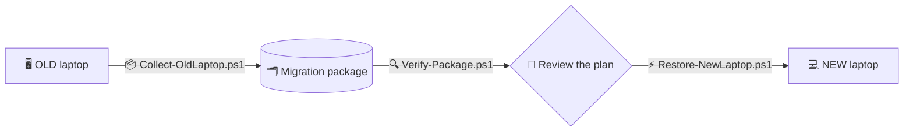

 

### 🖥️ ➜ 💻 &nbsp; Your whole Windows setup, from one laptop to the next

<a href="First-Time-Setup"><kbd>🧑‍🏫 First-time setup</kbd></a>
<a href="Getting-Started"><kbd>🚀 Getting started</kbd></a>
<a href="Using-the-GUI"><kbd>🖼️ GUI</kbd></a>
<a href="Collect-from-the-Old-Laptop"><kbd>📦 Collect</kbd></a>
<a href="Verify-the-Package"><kbd>🔍 Verify</kbd></a>
<a href="Restore-on-the-New-Laptop"><kbd>⚡ Restore</kbd></a>
<a href="No-Administrator-Rights"><kbd>🔓 No admin?</kbd></a>
<a href="Troubleshooting"><kbd>🧰 Troubleshooting</kbd></a>

---

## 🚦 The three steps

| | Step | Script | Runs on |
| :--: | :-- | :-- | :--: |
| 📦 | **[Collect](Collect-from-the-Old-Laptop)** | `Collect-OldLaptop.ps1` | 🖥️ old |
| 🔍 | **[Verify](Verify-the-Package)** | `Verify-Package.ps1` | 💻 new |
| ⚡ | **[Restore](Restore-on-the-New-Laptop)** | `Restore-NewLaptop.ps1` | 💻 new |

> [!TIP]
> **Brand new to this?** Start with **[🧑‍🏫 First-Time Setup](First-Time-Setup)** - it assumes you
> know nothing and shows every click. Then come back to [Getting Started](Getting-Started).
>
> **Prefer a window to typing?** Run `.\Start-MigrationGui.ps1` - see [🖼️ Using the GUI](Using-the-GUI).

---

## 📚 Browse the wiki

<table>
<tr>
<td valign="top" width="50%">

**🚀 Start here**
- [🏠 Home](Home)
- [🧑‍🏫 First-Time Setup (absolute beginner)](First-Time-Setup)
- [🖼️ Using the GUI](Using-the-GUI)
- [🚀 Getting Started](Getting-Started)
- [📦 Collect from the Old Laptop](Collect-from-the-Old-Laptop)
- [🔍 Verify the Package](Verify-the-Package)
- [⚡ Restore on the New Laptop](Restore-on-the-New-Laptop)

</td>
<td valign="top" width="50%">

**🎛️ Details &amp; help**
- [🎛️ App Selection and Granularity](App-Selection-and-Granularity)
- [⚠️ Conflicts and Version Mismatch](Conflicts-and-Version-Mismatch)
- [🔐 Security and Privacy](Security-and-Privacy)
- [🔓 No Administrator Rights](No-Administrator-Rights)
- [🧰 Troubleshooting](Troubleshooting)
- [❓ FAQ](FAQ)

</td>
</tr>
</table>

---

## ✨ What you get

| | |
| :-- | :-- |
| 🧰 **Apps** | winget inventory, per-app install / data / both / skip |
| 🎨 **Visuals** | theme, taskbar layout &amp; pins, wallpaper, input &amp; region |
| 🧑‍💻 **Dev &amp; agents** | VS Code, Windows Terminal, PowerShell profiles, opencode / Claude / Codex / Gemini / Cursor, dotfiles |
| 📶 **Wi-Fi** | profiles with passwords (collected elevated) |
| 🔤 **Fonts &amp; env** | user-installed fonts, user environment variables, power scheme |
| 🗂️ **Files** | optional Desktop / Documents / Downloads / Pictures / Videos / Music |

Everything the scripts overwrite is **backed up first** into a `MigrationBackup-<date>`
folder on the Desktop, with a full `restore-log.txt`.

> [!NOTE]
> **No Administrator rights?** Only Wi-Fi passwords and the power scheme need them -
> everything else is collected and restored as a standard user.
> See **[No Administrator Rights](No-Administrator-Rights)**.

---

**→ Back to the [repository](https://github.com/samayshetty/laptop-migration-toolkit)**

laptop-migration-toolkit · MIT · PowerShell 5.1 · Windows 10/11

